# 🌌 Project S – Think. Learn. Create. Grow.

**A free personal AI assistant and tutor in a single HTML file, by Shivanshu Sharma.** Hindi, Hinglish and English.

### 👉 Try it now: **[17shivanshusharma.github.io/Project-S](https://17shivanshusharma.github.io/Project-S/)**

> **100% free, sirf Google account chahiye.** Your key and chats stay in your own browser. We don't store any data.

S is a space-themed AI chat app that runs entirely in your browser. There is nothing to install and no server. Open the file, paste your own free API key, and start asking questions.

## 🎬 Watch the video

[](https://17shivanshusharma.github.io/Project-S/media/project-s-explainer.mp4)

**[▶ Watch the full video (about 2 minutes)](https://17shivanshusharma.github.io/Project-S/media/project-s-explainer.mp4)**: what S can do, how every subject gets its own colour, how S explains any question in easy language, the new study mode, memory and web search, how to make your free key, and why your data stays with you.


## ✨ Features

### 🔗 New in V2.1: real sources, safer and more reliable

- **Every fact with a real source:** S searches first and cites only links that came back from its own search, never links the AI makes up. Under each answer a **source check** shows how many real sources there are, flags wrong `[n]` numbers and links the AI typed itself, and warns "⚠ source nahi mila" when there is none. **🔍 Links check karo** opens each page and checks that it really talks about the same thing.
- **More reliable:** time limits, one automatic retry, half answers kept, no double sending, Stop always works.
- **Chats:** 📁 folders, search inside messages, export as PDF / Markdown / JSON, AI-written chat titles, long chats summarised instead of forgotten.
- **Privacy:** memory never saves phone numbers, passwords, keys, ID or bank details; Undo for every memory; 🕶 Temporary chat; keys can be kept only for the open tab; optional own server ([docs/BACKEND.md](docs/BACKEND.md)) so the Gemini key never touches the phone.
- **Safer backups and files:** restore checks the file and merges without deleting anything; fake or empty files are caught; PDF page count and 🔒 locked-PDF warning; 🎤 Mic test.
- Full report with exactly what was tested: [docs/V2.1-REPORT.md](docs/V2.1-REPORT.md).

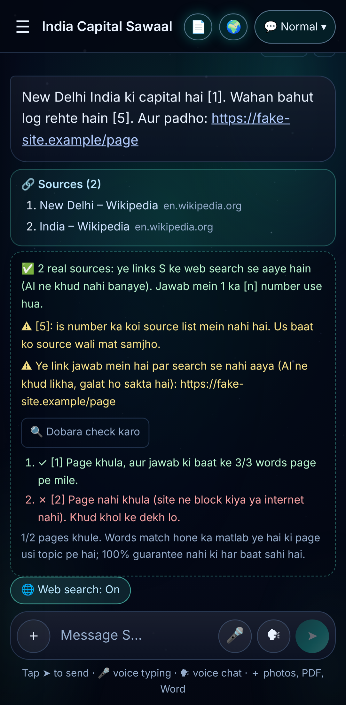

### 📄 New: PDF maker

- **Ask S for a PDF:** "Newton ke laws ki notes ki PDF bana do", "is chapter ka question paper PDF mein do"… S makes the document and shows a card with **⬇ Download PDF**, 🖨 Print, 👁 Preview and ⭐ save to Library. (Gemini and Claude. With OpenRouter, S writes the content and you tap 📄 PDF under the answer.)
- **📄 PDF button** under every answer, a **📄 button in the top bar** for the whole chat, and **📄 PDF** on every note and saved answer in the Library.
- Real A4 `.pdf` files, made inside your browser (nothing is uploaded). Hindi, Hinglish, emoji, maths formulas, tables and graphs all come out right. If a browser can't draw the pages, S opens the print screen, where you choose "Save as PDF".

| PDF card in chat | The downloaded PDF |
|---|---|
| 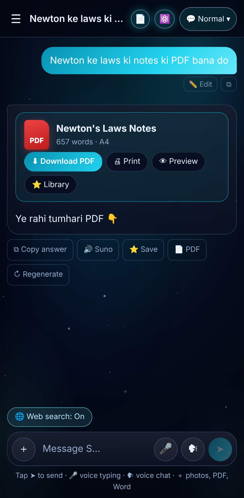 | 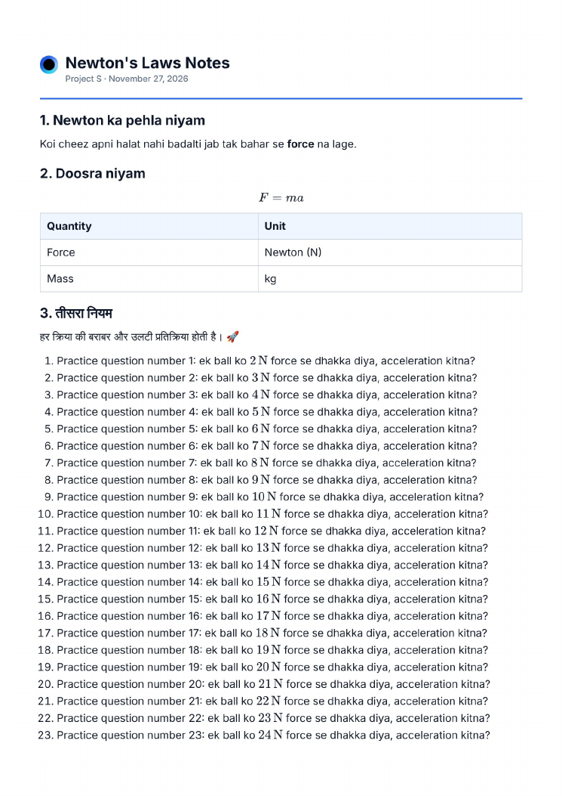 |

### 🚀 New in V2

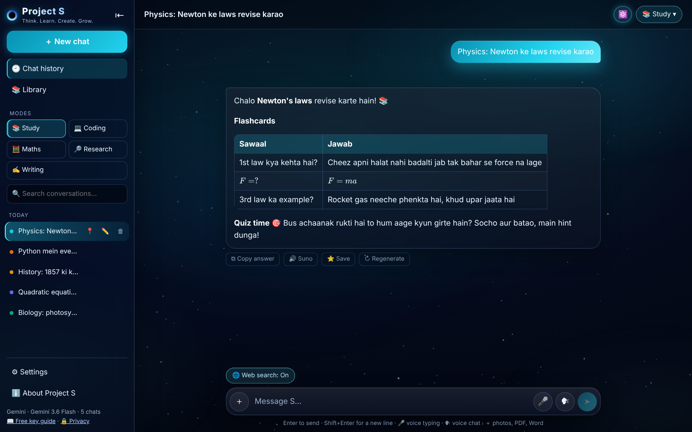

- **8 modes:** 💬 Normal, ⚡ Fast, 🧠 Reasoning, 💻 Coding, 📚 Study, 🧮 Maths, 🔎 Research and ✍️ Writing. Pick one from the top bar or the sidebar. Study mode has Beginner / Intermediate / Advanced levels; Writing mode has Professional, Simple, Academic, Casual, Concise and Detailed styles and a language choice.
- **Better chat:** ↻ Regenerate the last answer, ✏️ edit an earlier question and ask again, ↻ Retry after an error, ⭐ save any answer to the Library, a ↓ button to jump to the newest message, and clear error messages.
- **Code colours:** code blocks show the language name and are coloured (Python, JavaScript, HTML, CSS, Java, C, C++, SQL and more), with a Copy button. S doesn't run your code on your device.
- **📈 Maths graphs:** in Maths mode S can draw graphs of functions. The points are calculated by the real SymPy engine, not guessed. S only says "Checked with SymPy" when SymPy actually ran.
- **📘 Word files:** besides photos, PDF, TXT and Markdown, S now reads Word (.docx) files. Very long documents are split into parts, and S sends the parts that match your question. New 📒 Study notes button for any file.
- **🗣 Voice chat:** tap 🗣, speak, and S answers out loud, then listens again. A pill shows when the mic is on. In Settings you can pick S's voice and speaking speed. 🔊 Suno now has Pause, Resume and Stop. The mic only turns on when you tap it.
- **Sidebar:** chats grouped by date (Today, Yesterday, Previous 7 days…), 📌 pin important chats, rename, delete, search, mode shortcuts, ℹ️ About page. On a laptop you can hide the sidebar.
- **📚 Library with three tabs:** 📁 Files, ⭐ Saved answers and 📝 Notes (write your own notes, with maths). Search, rename, delete and export as Markdown.
- **🧠 Memory you control:** turn it off, see it, edit it, delete it, or add things yourself.
- **Personalization:** reply language (Auto, Hinglish, Hindi, English), answer style (Concise, Balanced, Detailed, Beginner-friendly), study level and writing style.
- **Settings in sections:** AI, Look, Personal, Voice, Memory, Privacy and About. 🔌 Test key checks that your key works, 🗑 Remove key deletes it from the browser, and Storage shows how much space S uses. Backups now include your Library too.
- **Works on every screen:** phones (Android and iPhone), tablets, laptops and desktops.

| Maths graph | Library | Settings |
|---|---|---|
| 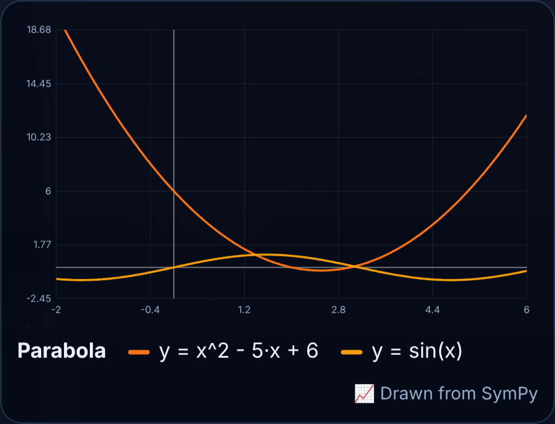 |  |  |

### Earlier: v4

- **🎨 Every subject gets its own colour:** S notices the subject of a chat (maths, physics, chemistry, biology, history, geography, English/Hindi, coding, commerce) and gives *only that chat* its own theme. Maths is indigo, biology green, history amber, coding orange, and so on. A new chat starts in the normal blue. Tap the round badge at the top to pick a different subject yourself.
- **📚 Study mode:** S becomes a tutor. It gives hints one at a time, asks you questions, and makes quizzes, flashcards and revision sheets.
- **🧠 Memory:** say "yaad rakhna, main class 12 mein hoon" and S remembers it in every chat. See or delete what it remembers in ⚙ Settings. It stays only in your browser.
- **🔊 Suno:** S reads any answer out loud (Hindi or English voice, built into your phone).
- **✏️ Rename chats** and **💾 back up / restore** all chats as a file, so you can move them to a new phone. The backup never contains your API key.
- **🔒 Stronger security:** the app can only talk to the AI providers, the maths engine download, Wikipedia and the page reader. Nothing else.
- **📱 Smooth on Android and iPhone:** no zoom when you type on iPhone, room for the notch and home bar, bigger buttons, smooth scrolling, and fewer animations when your phone asks for reduced motion.

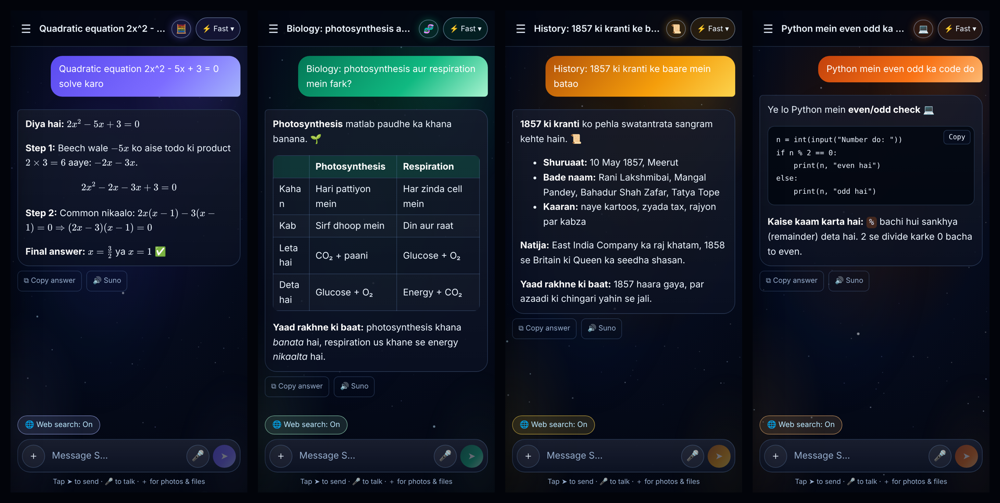

| Study mode | Pick a subject | Memory + backup |
|---|---|---|
| 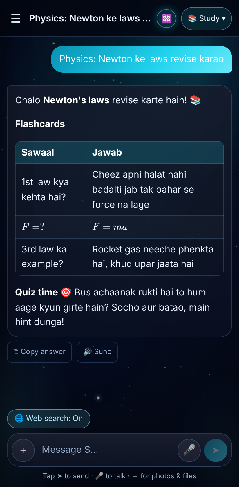 | 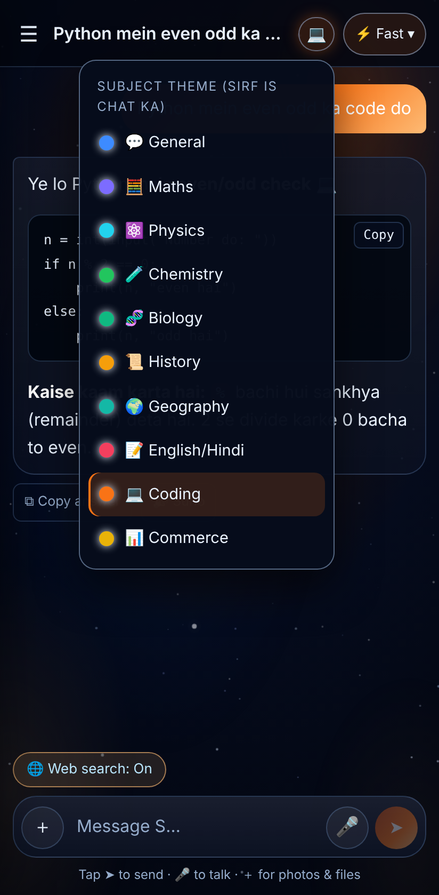 | 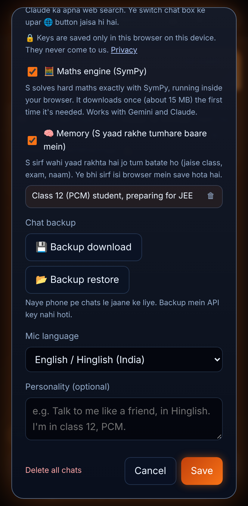 |

**From v3**

- **New look:** deep navy and black with electric blue accents. A clean, distraction-free chat screen.
- **Sidebar:** ＋ New chat, 🕘 History (with search), 📚 Library and ⚙ Settings.
- **📚 Library:** every photo, PDF and note you've uploaded, in one place. Tap **Summarize** or **Ask a question** to start a new chat with that file.
- **Document tools:** attach a PDF, photo or notes and tap 📝 Summarize, 🔑 Key points, ❓ Quiz me or 🔍 Explain. S answers from the file and says where in it the answer is.
- **🌐 Real web search with sources:** S searches when a question needs fresh information, can read and summarize several websites, lists the source links under the answer, and keeps **✅ verified facts** separate from **🤔 guesses**.
- **Smart model selector:** ⚡ Fast, 🧠 Reasoning and 💻 Coding modes pick the best model for the job, or choose a model yourself. If a model fails, S tries the next one, and then your other brain (for example OpenRouter) if you've added its key.
- **Better answers:** tables, code blocks with Copy buttons, and a Copy answer button.

| Web search with sources | Modes | Library |
|---|---|---|
|  | 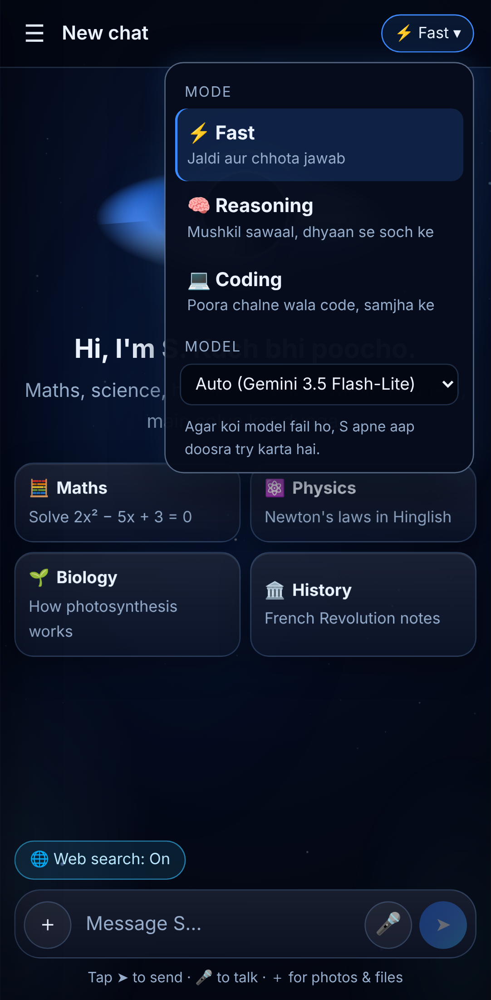 |  |

**Everything else**


- **One file:** the whole app is `index.html` (about 1 MB). Open it on a phone or computer.
- **Free to use:** works with a free Google Gemini key. OpenRouter (free) and Claude (paid) are also supported.
- **Easy explanations:** S explains any question in simple everyday words, in small steps, with real-life examples, a check of the answer and a "yaad rakhne ki baat" at the end.
- **Every subject:** maths, physics, chemistry, biology, history, English, coding, plus JEE and NEET prep. Maths is solved step by step, and formulas are rendered properly.
- **Real maths engine (SymPy):** for hard maths (equations, integrals, limits, differential equations, matrices), S runs real Python with [SymPy](https://www.sympy.org) inside your browser and shows the calculation in a small fold-out box. It downloads once (about 15 MB) the first time, using [Pyodide](https://pyodide.org). Works with Gemini and Claude; you can turn it off in Settings.
- **Photos and files:** the ＋ button opens the camera, photos, PDFs or text files. Take a photo of a question and S solves it.
- **Voice typing:** tap 🎤 and speak, in English, Hinglish or Hindi.
- **Hinglish support:** S replies in the language you write in.
- **Space feel:** a blue black hole intro animation and a calm, subtle starfield behind the chat.
- **Long chats, saved on your device:** chats are stored in your browser (IndexedDB), so you can keep thousands of them.
- **Private:** your API key and chats stay in your own browser. They are only sent to the AI provider you choose.

| Home | Settings |
|---|---|
| 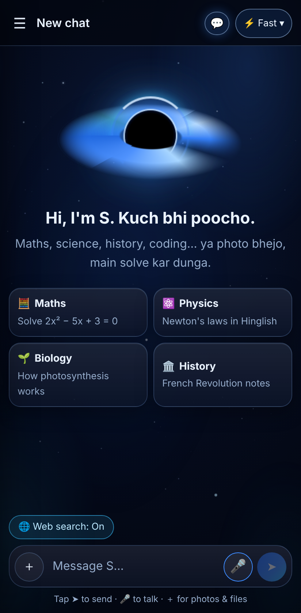 |  |

### 🧮 Example: a maths question, explained step by step

S explains every answer in simple words, one small step at a time: what the question means, why each step is done, a check, and one line to remember. For hard maths it also checks the answer with SymPy.


## 🗺️ Roadmap

| Phase | Work | Status |
|---|---|---|
| 1 | Security + chat history + bug fixes | ✅ Done: locked-down connections (Content Security Policy), no key in backups, rename chats, backup and restore |
| 2 | Voice + PDF + image understanding | ✅ Done: 🎤 voice typing, 🔊 read aloud, PDFs, photos and notes with Summarize / Key points / Quiz / Explain |
| 3 | Web search + citations + memory | ✅ Done: web search, numbered sources, verified facts vs guesses, 🧠 memory |
| 4 | Study mode + coding mode + maths | ✅ Done: 📚 Study, 💻 Coding, 🧠 Reasoning, SymPy maths engine |
| 5 | Premium UI + mobile optimisation | ✅ Done: subject themes, navy + blue design, Android and iPhone polish |
| V2 | Full upgrade: 8 modes, graphs, voice chat, Library, personalization | ✅ Done (see "New in V2") |
| V2.1 | Real sources + source check, reliability, folders, memory privacy, safe backups, file checks | ✅ Done ([report](docs/V2.1-REPORT.md)) |
| 6 | Backend + authentication + deployment | 🔜 Next. Today S has no server on purpose, so nobody can see your data. A login and cloud sync need a backend account (for example Firebase or Supabase, both have free plans) owned by the project. Deployment is already done with GitHub Pages. |

## 🚀 How to use

1. Open **[17shivanshusharma.github.io/Project-S](https://17shivanshusharma.github.io/Project-S/)**, or download `index.html` (you can rename it to `S.html`).
2. Works in Chrome, Edge, Safari and Firefox. On Android use Chrome; on iPhone use Safari. Tip: "Add to Home Screen" makes it open like an app.
3. Get a free Gemini API key:
   - Go to [aistudio.google.com/apikey](https://aistudio.google.com/apikey)
   - Sign in with Google and tap **Create API key**
   - Copy the key (it starts with `AIza`)
4. Paste the key into S's Settings box and tap **Save**. Done!

### Other brains (optional)

| Brain | Cost | Key from |
|---|---|---|
| Google Gemini (default) | Free daily limit | [aistudio.google.com/apikey](https://aistudio.google.com/apikey) |
| OpenRouter | Free models | [openrouter.ai/keys](https://openrouter.ai/keys) |
| Claude | Paid | [console.anthropic.com](https://console.anthropic.com/settings/keys) |

Switch brains anytime from ☰ → ⚙ Settings.

> **Note:** free keys have daily limits set by the provider. For example, Gemini 3.5 Flash-Lite allows roughly 500 messages a day. If one Gemini model hits its limit, S automatically tries the other free Gemini models.

## 🔑 Free key kaise banaye (1 minute)

1. Open [aistudio.google.com/apikey](https://aistudio.google.com/apikey).
2. Sign in with your Google account (the same Gmail that's on your phone).
3. Tap **Create API key**. If it asks for a project, pick the first one.
4. Copy the key (it starts with `AIza`) and paste it into S. Done!


S shows this same guide on the first screen. You can open it again anytime from ☰ → 📖 Free key guide.

## 🔒 Privacy

- **We don't store any data.** S has no server. Your chats and your key are saved only in your own browser.
- When you ask something, your message goes straight to the AI you picked (Google Gemini by default) so it can answer. On the free Gemini tier, Google may use messages to improve its services, so don't send very personal information.
- To delete your chats: ☰ → ⚙ Settings → **Delete all chats**.

## 🛡️ Security

- **No API key is included in this project.** Every user adds their own key in Settings.
- Your key is saved only in your browser's local storage on your device, and S sends it only to the provider it belongs to.
- **Be honest about the limits:** browser storage is not a safe. Anyone who uses your phone, or a harmful browser extension, could read the key. Hiding it with "Show/Hide" doesn't protect it. So:
  - Never share your key and **never commit it to GitHub**.
  - In Google AI Studio / Google Cloud, restrict the key to the "Generative Language API" only.
  - If a key leaks, delete it and create a new one. In S use ⚙ Settings → 🗑 Remove key.
- The page has a Content Security Policy, so it can only talk to the AI providers, the maths engine download (jsDelivr), Wikipedia, the page reader (r.jina.ai) and your own `*.workers.dev` server.
- Backups never contain your keys (if a key was pasted into a chat, the backup replaces it with "[API key removed]").
- **🔑 Keys is device pe yaad rakho** can be turned off: then the key lasts only until the tab is closed. Use this on shared phones or computers.
- **Own server (optional):** [`backend/worker.js`](backend/worker.js) is a small Cloudflare Worker that keeps the Gemini key as a server secret, with origin, model, size and rate limits. See [docs/BACKEND.md](docs/BACKEND.md). It is built and tested locally but not deployed for you.
- Memory never saves phone numbers, emails, passwords, API keys, ID numbers, bank details or addresses.
- A server that keeps one shared key safely (with rate limits and logins) is possible, but it needs a backend account. GitHub Pages can only host static files, so that is Phase 6.

## 💻 S in many programming languages

Besides the web app (HTML, CSS and JavaScript), S also comes as a terminal chat in five more languages. Each version is one file, talks to the free Gemini API, tries the next free model when one hits its limit, remembers the whole chat, and supports `/new` (new chat) and `/exit`.

| Language | File | Run it |
|---|---|---|
| 🐍 Python 3.8+ | [`languages/python/s.py`](languages/python/s.py) | `python s.py` |
| ☕ Java 11+ | [`languages/java/S.java`](languages/java/S.java) | `java S.java` |
| ⚙️ C++17 | [`languages/cpp/s.cpp`](languages/cpp/s.cpp) | `g++ -std=c++17 -O2 s.cpp -lcurl -o s` then `./s` |
| 🔧 C | [`languages/c/s.c`](languages/c/s.c) | `gcc -O2 s.c -lcurl -o s` then `./s` |
| 🟨 JavaScript (Node.js 18+) | [`languages/javascript/s.js`](languages/javascript/s.js) | `node s.js` |

Python, Java and JavaScript need no extra packages. C and C++ need libcurl (`sudo apt install libcurl4-openssl-dev` on Ubuntu/Debian). Each version asks for your Gemini key when it starts, or you can set it once:

```bash
export GEMINI_API_KEY="your-key-here"      # Windows PowerShell: $env:GEMINI_API_KEY="your-key-here"
```

On an Android phone, the Python version runs in the free **Pydroid 3** app.

## 🛠️ For developers

`index.html` is built from the source in [`source/`](source/):

```bash
cd source
npm ci           # exact versions from package-lock.json, so the build is reproducible
npm run build      # writes out/S.html, then copy it to ../index.html
```

- `src/app.js`: chat logic, the providers (Gemini, OpenRouter, Claude), attachments, mic and storage
- `src/sympy.js`: the SymPy maths engine (Pyodide in a Web Worker)
- `src/docx.js`: reads Word (.docx) files in the browser (no library)
- `src/graph.js`: draws SymPy graphs as SVG
- `src/pdf.js`: makes A4 PDF files in the browser (pages drawn as images, packed into a PDF; print fallback)
- `src/subjects.js`: the subject detector and the colour theme for each subject
- `src/search.js`: web search (Google Search via your Gemini key when allowed, otherwise Wikipedia + a free page reader)
- `src/space.js`: the 3D starfield
- `src/intro.js`: the black hole intro animation
- `src/style.css` and `src/template.html`: the look and the layout
- `src/fx.css`: the v3 design layer, loaded after `style.css` (see Design below)
- `video/`: the explainer video (`video.html` is the animation, `render.cjs` turns it into frames for ffmpeg)
- `../docs/V2-REPORT.md`: what V2 added, what was tested, and what still needs a backend
- `build.cjs`: bundles everything, including the KaTeX maths fonts, into one HTML file

### 🎨 Design (v3)

A study notebook at night. Every feature and button is where it was; only the look changed.

- **Notebook:** faint ruled lines, a red margin line, a hand-drawn underline and a handwritten note on the welcome page. S writes its answers straight on the page, like notes in a copy.
- **Calm:** flat surfaces, solid 1px borders, one accent colour (the subject colour), no glow and no gradient text.
- **Space, quietly:** the black hole and the stars stay, smaller and dimmer.
- **Fonts:** [Fraunces](https://fonts.google.com/specimen/Fraunces) for headings, [Inter](https://rsms.me/inter/) for text, [Caveat](https://fonts.google.com/specimen/Caveat) for the handwritten notes (all SIL Open Font License), embedded so the file still works offline.

Built with [highlight.js](https://highlightjs.org), [marked](https://github.com/markedjs/marked), [DOMPurify](https://github.com/cure53/DOMPurify), [KaTeX](https://katex.org) and the [Anthropic SDK](https://github.com/anthropics/anthropic-sdk-typescript).

---

### 🇮🇳 Hinglish mein

S ek AI assistant hai jo ek hi HTML file mein chalta hai. Kuch install nahi karna. File kholo, apni free Gemini key daalo ([aistudio.google.com/apikey](https://aistudio.google.com/apikey) se), aur kuch bhi poocho: maths, science, history, coding, sab kuch. Question ki photo bhejo, ya 🎤 dabake bolo. Tumhari key aur chats sirf tumhare phone mein rehti hain. Har subject ki chat ka apna rang hota hai (maths indigo, biology hara, history sunehra, coding orange), 📚 Study mode quiz aur flashcards banata hai, aur 🧠 Memory tumhari class aur exam yaad rakhti hai. Android aur iPhone dono pe smooth chalta hai.

**Made with 💜 by Shivanshu Sharma**
