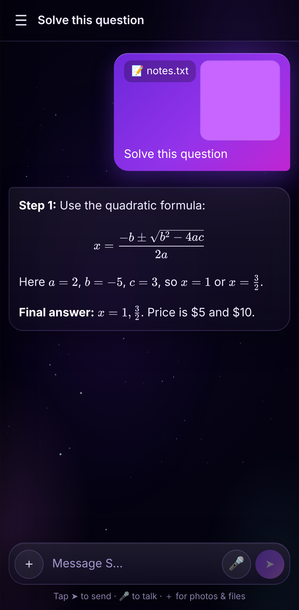
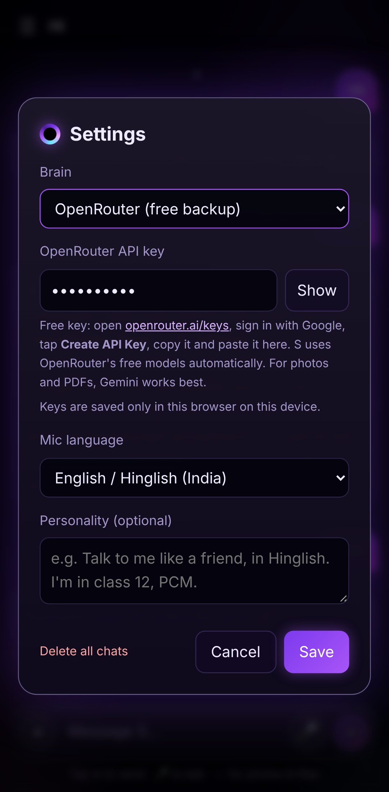

# 🌌 Project S

**A personal AI assistant in a single HTML file, by Shivanshu Sharma.**

S is a space-themed AI chat app that runs entirely in your browser. There is nothing to install and no server. Open the file, paste your own free API key, and start asking questions.


## ✨ Features

- **One file:** the whole app is `index.html` (about 1 MB). Open it on a phone or computer.
- **Free to use:** works with a free Google Gemini key. OpenRouter (free) and Claude (paid) are also supported.
- **Every subject:** maths, physics, chemistry, biology, history, English, coding, plus JEE and NEET prep. Maths is solved step by step, and formulas are rendered properly.
- **Real maths engine (SymPy):** for hard maths (equations, integrals, limits, differential equations, matrices), S runs real Python with [SymPy](https://www.sympy.org) inside your browser and shows the calculation in a small fold-out box. It downloads once (about 15 MB) the first time, using [Pyodide](https://pyodide.org). Works with Gemini and Claude; you can turn it off in Settings.
- **Photos and files:** the ＋ button opens the camera, photos, PDFs or text files. Take a photo of a question and S solves it.
- **Voice typing:** tap 🎤 and speak, in English, Hinglish or Hindi.
- **Hinglish support:** S replies in the language you write in.
- **3D space look:** a black hole intro animation, a moving 3D starfield, a spinning black hole and glass panels.
- **Long chats, saved on your device:** chats are stored in your browser (IndexedDB), so you can keep thousands of them.
- **Private:** your API key and chats stay in your own browser. They are only sent to the AI provider you choose.

| Home | Maths | Settings |
|---|---|---|
|  |  |  |

## 🚀 How to use

1. Download `index.html` (you can rename it to `S.html`).
2. Open it in Chrome, Edge or any modern browser. On Android, open it from your file manager with Chrome.
3. Get a free Gemini API key:
   - Go to [aistudio.google.com/apikey](https://aistudio.google.com/apikey)
   - Sign in with Google and tap **Create API key**
   - Copy the key (it starts with `AIza`)
4. Paste the key into S's Settings box and tap **Save**. Done!

### Other brains (optional)

| Brain | Cost | Key from |
|---|---|---|
| Google Gemini (default) | Free daily limit | [aistudio.google.com/apikey](https://aistudio.google.com/apikey) |
| OpenRouter | Free models | [openrouter.ai/keys](https://openrouter.ai/keys) |
| Claude | Paid | [console.anthropic.com](https://console.anthropic.com/settings/keys) |

Switch brains anytime from ☰ → ⚙ Settings.

> **Note:** free keys have daily limits set by the provider. For example, Gemini 3.5 Flash-Lite allows roughly 500 messages a day. If one Gemini model hits its limit, S automatically tries the other free Gemini models.

## 🔒 Security

- **No API key is included in this project.** Every user adds their own key in Settings.
- Your key is saved only in your browser's local storage on your device.
- **Never commit your API key to GitHub.** If a key ever leaks, delete it and create a new one.

## 💻 S in many programming languages

Besides the web app (HTML, CSS and JavaScript), S also comes as a terminal chat in five more languages. Each version is one file, talks to the free Gemini API, tries the next free model when one hits its limit, remembers the whole chat, and supports `/new` (new chat) and `/exit`.

| Language | File | Run it |
|---|---|---|
| 🐍 Python 3.8+ | [`languages/python/s.py`](languages/python/s.py) | `python s.py` |
| ☕ Java 11+ | [`languages/java/S.java`](languages/java/S.java) | `java S.java` |
| ⚙️ C++17 | [`languages/cpp/s.cpp`](languages/cpp/s.cpp) | `g++ -std=c++17 -O2 s.cpp -lcurl -o s` then `./s` |
| 🔧 C | [`languages/c/s.c`](languages/c/s.c) | `gcc -O2 s.c -lcurl -o s` then `./s` |
| 🟨 JavaScript (Node.js 18+) | [`languages/javascript/s.js`](languages/javascript/s.js) | `node s.js` |

Python, Java and JavaScript need no extra packages. C and C++ need libcurl (`sudo apt install libcurl4-openssl-dev` on Ubuntu/Debian). Each version asks for your Gemini key when it starts, or you can set it once:

```bash
export GEMINI_API_KEY="your-key-here"      # Windows PowerShell: $env:GEMINI_API_KEY="your-key-here"
```

On an Android phone, the Python version runs in the free **Pydroid 3** app.

## 🛠️ For developers

`index.html` is built from the source in [`source/`](source/):

```bash
cd source
npm install
npm run build      # writes out/S.html
```

- `src/app.js`: chat logic, the providers (Gemini, OpenRouter, Claude), attachments, mic and storage
- `src/sympy.js`: the SymPy maths engine (Pyodide in a Web Worker)
- `src/space.js`: the 3D starfield
- `src/intro.js`: the black hole intro animation
- `src/style.css` and `src/template.html`: the look and the layout
- `build.cjs`: bundles everything, including the KaTeX maths fonts, into one HTML file

Built with [marked](https://github.com/markedjs/marked), [DOMPurify](https://github.com/cure53/DOMPurify), [KaTeX](https://katex.org) and the [Anthropic SDK](https://github.com/anthropics/anthropic-sdk-typescript).

---

### 🇮🇳 Hinglish mein

S ek AI assistant hai jo ek hi HTML file mein chalta hai. Kuch install nahi karna. File kholo, apni free Gemini key daalo ([aistudio.google.com/apikey](https://aistudio.google.com/apikey) se), aur kuch bhi poocho: maths, science, history, coding, sab kuch. Question ki photo bhejo, ya 🎤 dabake bolo. Tumhari key aur chats sirf tumhare phone mein rehti hain.

**Made with 💜 by Shivanshu Sharma**
