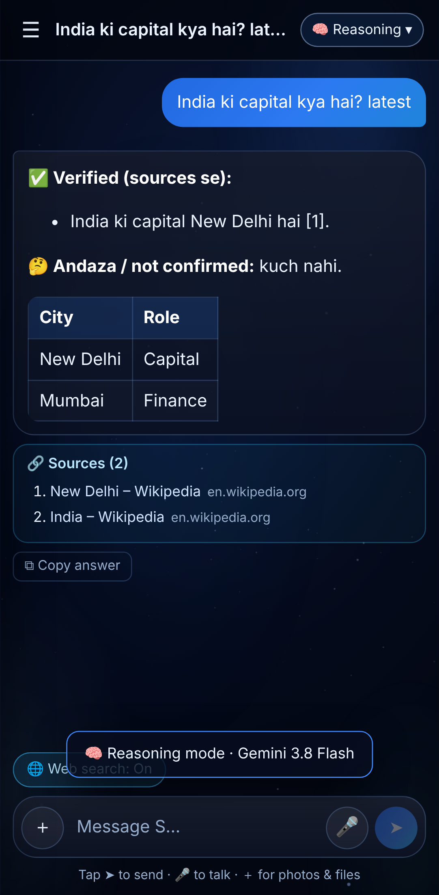
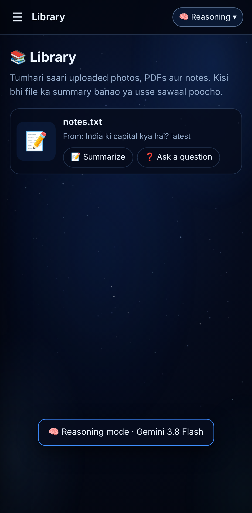
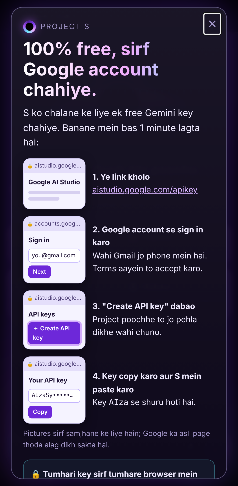

# 🌌 Project S – Free Hinglish AI for Students

**A personal AI in a single HTML file, by Shivanshu Sharma.**

### 👉 Try it now: **[17shivanshusharma.github.io/Project-S](https://17shivanshusharma.github.io/Project-S/)**

> **100% free, sirf Google account chahiye.** Your key and chats stay in your own browser. We don't store any data.

S is a space-themed AI chat app that runs entirely in your browser. There is nothing to install and no server. Open the file, paste your own free API key, and start asking questions.

## 🎬 Watch the video

[](https://17shivanshusharma.github.io/Project-S/media/project-s-explainer.mp4)

**[▶ Watch the full video (85 seconds)](https://17shivanshusharma.github.io/Project-S/media/project-s-explainer.mp4)**: what S can do, how it explains any question in easy language, how to make your free key, and why your data stays with you.


## ✨ Features

**New in this version**

- **New look:** deep navy and black with electric blue accents. A clean, distraction-free chat screen.
- **Sidebar:** ＋ New chat, 🕘 History (with search), 📚 Library and ⚙ Settings.
- **📚 Library:** every photo, PDF and note you've uploaded, in one place. Tap **Summarize** or **Ask a question** to start a new chat with that file.
- **Document tools:** attach a PDF, photo or notes and tap 📝 Summarize, 🔑 Key points, ❓ Quiz me or 🔍 Explain. S answers from the file and says where in it the answer is.
- **🌐 Real web search with sources:** S searches when a question needs fresh information, can read and summarize several websites, lists the source links under the answer, and keeps **✅ verified facts** separate from **🤔 guesses**.
- **Smart model selector:** ⚡ Fast, 🧠 Reasoning and 💻 Coding modes pick the best model for the job, or choose a model yourself. If a model fails, S tries the next one, and then your other brain (for example OpenRouter) if you've added its key.
- **Better answers:** tables, code blocks with Copy buttons, and a Copy answer button.

| Web search with sources | Modes | Library |
|---|---|---|
|  |  |  |

**Everything else**


- **One file:** the whole app is `index.html` (about 1 MB). Open it on a phone or computer.
- **Free to use:** works with a free Google Gemini key. OpenRouter (free) and Claude (paid) are also supported.
- **Easy explanations:** S explains any question in simple everyday words, in small steps, with real-life examples, a check of the answer and a "yaad rakhne ki baat" at the end.
- **Every subject:** maths, physics, chemistry, biology, history, English, coding, plus JEE and NEET prep. Maths is solved step by step, and formulas are rendered properly.
- **Real maths engine (SymPy):** for hard maths (equations, integrals, limits, differential equations, matrices), S runs real Python with [SymPy](https://www.sympy.org) inside your browser and shows the calculation in a small fold-out box. It downloads once (about 15 MB) the first time, using [Pyodide](https://pyodide.org). Works with Gemini and Claude; you can turn it off in Settings.
- **Photos and files:** the ＋ button opens the camera, photos, PDFs or text files. Take a photo of a question and S solves it.
- **Voice typing:** tap 🎤 and speak, in English, Hinglish or Hindi.
- **Hinglish support:** S replies in the language you write in.
- **Space feel:** a blue black hole intro animation and a calm, subtle starfield behind the chat.
- **Long chats, saved on your device:** chats are stored in your browser (IndexedDB), so you can keep thousands of them.
- **Private:** your API key and chats stay in your own browser. They are only sent to the AI provider you choose.

| Home | Settings |
|---|---|
|  |  |

### 🧮 Example: a maths question, explained step by step

S explains every answer in simple words, one small step at a time: what the question means, why each step is done, a check, and one line to remember. For hard maths it also checks the answer with SymPy.


## 🚀 How to use

1. Download `index.html` (you can rename it to `S.html`).
2. Open it in Chrome, Edge or any modern browser. On Android, open it from your file manager with Chrome.
3. Get a free Gemini API key:
   - Go to [aistudio.google.com/apikey](https://aistudio.google.com/apikey)
   - Sign in with Google and tap **Create API key**
   - Copy the key (it starts with `AIza`)
4. Paste the key into S's Settings box and tap **Save**. Done!

### Other brains (optional)

| Brain | Cost | Key from |
|---|---|---|
| Google Gemini (default) | Free daily limit | [aistudio.google.com/apikey](https://aistudio.google.com/apikey) |
| OpenRouter | Free models | [openrouter.ai/keys](https://openrouter.ai/keys) |
| Claude | Paid | [console.anthropic.com](https://console.anthropic.com/settings/keys) |

Switch brains anytime from ☰ → ⚙ Settings.

> **Note:** free keys have daily limits set by the provider. For example, Gemini 3.5 Flash-Lite allows roughly 500 messages a day. If one Gemini model hits its limit, S automatically tries the other free Gemini models.

## 🔑 Free key kaise banaye (1 minute)

1. Open [aistudio.google.com/apikey](https://aistudio.google.com/apikey).
2. Sign in with your Google account (the same Gmail that's on your phone).
3. Tap **Create API key**. If it asks for a project, pick the first one.
4. Copy the key (it starts with `AIza`) and paste it into S. Done!



S shows this same guide on the first screen. You can open it again anytime from ☰ → 📖 Free key guide.

## 🔒 Privacy

- **We don't store any data.** S has no server. Your chats and your key are saved only in your own browser.
- When you ask something, your message goes straight to the AI you picked (Google Gemini by default) so it can answer. On the free Gemini tier, Google may use messages to improve its services, so don't send very personal information.
- To delete your chats: ☰ → ⚙ Settings → **Delete all chats**.

## 🛡️ Security

- **No API key is included in this project.** Every user adds their own key in Settings.
- Your key is saved only in your browser's local storage on your device.
- **Never commit your API key to GitHub.** If a key ever leaks, delete it and create a new one.

## 💻 S in many programming languages

Besides the web app (HTML, CSS and JavaScript), S also comes as a terminal chat in five more languages. Each version is one file, talks to the free Gemini API, tries the next free model when one hits its limit, remembers the whole chat, and supports `/new` (new chat) and `/exit`.

| Language | File | Run it |
|---|---|---|
| 🐍 Python 3.8+ | [`languages/python/s.py`](languages/python/s.py) | `python s.py` |
| ☕ Java 11+ | [`languages/java/S.java`](languages/java/S.java) | `java S.java` |
| ⚙️ C++17 | [`languages/cpp/s.cpp`](languages/cpp/s.cpp) | `g++ -std=c++17 -O2 s.cpp -lcurl -o s` then `./s` |
| 🔧 C | [`languages/c/s.c`](languages/c/s.c) | `gcc -O2 s.c -lcurl -o s` then `./s` |
| 🟨 JavaScript (Node.js 18+) | [`languages/javascript/s.js`](languages/javascript/s.js) | `node s.js` |

Python, Java and JavaScript need no extra packages. C and C++ need libcurl (`sudo apt install libcurl4-openssl-dev` on Ubuntu/Debian). Each version asks for your Gemini key when it starts, or you can set it once:

```bash
export GEMINI_API_KEY="your-key-here"      # Windows PowerShell: $env:GEMINI_API_KEY="your-key-here"
```

On an Android phone, the Python version runs in the free **Pydroid 3** app.

## 🛠️ For developers

`index.html` is built from the source in [`source/`](source/):

```bash
cd source
npm install
npm run build      # writes out/S.html
```

- `src/app.js`: chat logic, the providers (Gemini, OpenRouter, Claude), attachments, mic and storage
- `src/sympy.js`: the SymPy maths engine (Pyodide in a Web Worker)
- `src/search.js`: web search (Google Search via your Gemini key when allowed, otherwise Wikipedia + a free page reader)
- `src/space.js`: the 3D starfield
- `src/intro.js`: the black hole intro animation
- `src/style.css` and `src/template.html`: the look and the layout
- `video/`: the explainer video (`video.html` is the animation, `render.cjs` turns it into frames for ffmpeg)
- `build.cjs`: bundles everything, including the KaTeX maths fonts, into one HTML file

Built with [marked](https://github.com/markedjs/marked), [DOMPurify](https://github.com/cure53/DOMPurify), [KaTeX](https://katex.org) and the [Anthropic SDK](https://github.com/anthropics/anthropic-sdk-typescript).

---

### 🇮🇳 Hinglish mein

S ek AI assistant hai jo ek hi HTML file mein chalta hai. Kuch install nahi karna. File kholo, apni free Gemini key daalo ([aistudio.google.com/apikey](https://aistudio.google.com/apikey) se), aur kuch bhi poocho: maths, science, history, coding, sab kuch. Question ki photo bhejo, ya 🎤 dabake bolo. Tumhari key aur chats sirf tumhare phone mein rehti hain.

**Made with 💜 by Shivanshu Sharma**
